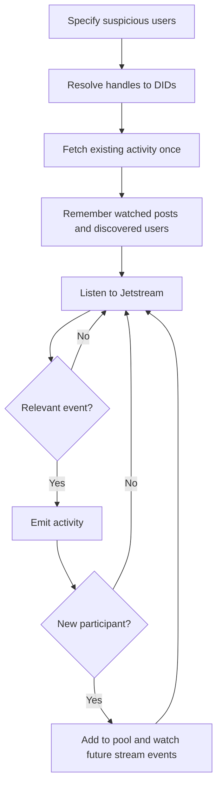

# Bluesky Initial Collection and WebSocket Streaming

The two files handle different parts of collection:

- **`app/platforms/bluesky.py` fetches activity that already exists.**
- **`app/streaming.py` listens for activity happening now.**

Despite the name `poll_user()`, we no longer call it repeatedly on a timer. Each original seed account gets one initial fetch attempt. Discovered accounts are monitored only through the stream. After that, the WebSocket handles new activity.



## Terms used in the code

| Term | Meaning |
| --- | --- |
| Handle | A readable account name, such as `alice.bsky.social` |
| DID | The account’s stable native ID, such as `did:plc:abc` |
| URI | A native record ID, such as `at://did:plc:abc/app.bsky.feed.post/123` |
| Cursor | A bookmark indicating where to continue reading |
| Pagination | Fetching results in several small pages |
| Backfill | Fetching existing activity before processing live changes |
| Pool | Accounts whose own posts we monitor |
| Watched posts | Top-level posts we know belong to monitored accounts |
| Emit | Send a result to the configured output function; currently, print JSON |

A user DID identifies **who**. A post URI identifies **which post**.

## Part 1: `app/platforms/bluesky.py`

`BlueskyPlatform` wraps the ordinary Bluesky HTTP API. It uses the atproto SDK to make requests and turn responses into Python objects.

### 1. `__init__()` creates the API client

```python
def __init__(self, *, page_size=25, max_pages=2, client=None):
```

Its arguments mean:

- `page_size`: how many results to request in one listing page.
- `max_pages`: how many listing pages we allow.
- `client`: an optional existing client, mainly useful for tests.

The `*` means these arguments must be named:

```python
BlueskyPlatform(page_size=25, max_pages=2)
```

The code checks that page size is between 1 and 100 and that at least one page is allowed. This prevents invalid requests.

If no client was supplied, it creates a `Request` with a 30-second timeout and an atproto `Client` pointing at `https://public.api.bsky.app`.

The SDK handles the low-level HTTP requests and response parsing. Our code works with Python objects instead of manually building every HTTP request.

### 2. `close()` releases HTTP resources

```python
if self._request is not None:
    self._request.close()
```

We close only the request object we created ourselves. When someone supplies a client, they remain responsible for its resources. This matters in tests and when sharing a client elsewhere.

### 3. `_user()` converts a profile into our `User` model

```python
User(
    user_id=profile.did,
    display_name=profile.handle,
    is_synthetic=False,
)
```

Bluesky profiles contain many properties. We keep the fields our application needs.

Most importantly, `user_id` is the native DID. There is no extra `bluesky:user:` prefix.

`is_synthetic=False` identifies this as a real platform account rather than a fictional demo user.

`@staticmethod` means this helper does not need access to a particular `BlueskyPlatform` instance.

### 4. `resolve_user()` looks up the initial account

```python
actor = handle.strip().removeprefix('@')
```

This accepts an input such as ` @alice.bsky.social` and cleans it to `alice.bsky.social`.

It rejects empty values, internal whitespace, and `/` characters. It then calls:

```python
self.client.get_profile(actor)
```

The returned profile is converted with `_user()`.

The separation is:

```text
resolve_user(handle) → User containing a DID
poll_user(user)      → use that DID directly
```

`poll_user()` does not resolve the account again.

### 5. `poll_user()` prepares containers for existing activity

```python
users = {user.user_id: user}
contents, discovered, authored, interactions = {}, {}, {}, {}
```

Each dictionary has a different purpose:

| Dictionary | What it holds |
| --- | --- |
| `users` | All accounts included in the fetched activity |
| `contents` | Posts and direct comments |
| `discovered` | Participants who may enter the monitoring pool |
| `authored` | The monitored account’s top-level posts |
| `interactions` | Likes and reposts |

Dictionaries prevent repeated IDs from producing duplicate entries within the same fetch. If one commenter appears on three posts, `users` still contains one entry for their DID.

### 6. The inner `add()` function converts a post or comment

```python
def add(post, participant=False):
```

This helper handles both top-level posts and comments because Bluesky represents both using post records.

It:

1. Checks that the record is a supported post record.
2. Converts the author into a `User`.
3. Checks whether the record replies to something.
4. Creates a `Content` object.
5. Saves the content by its native URI.
6. Optionally records the author as a discovered participant.

The parent determines the content type:

```text
No parent → post
Has parent → comment
```

The IDs remain directly usable:

```python
content_id = post.uri
user_id = actor.user_id
parent_id = parent
```

`participant=True` means the author directly interacted with the monitored user’s post and should be considered for the pool. The monitored user is excluded from discovering themselves.

### 7. Fetch the monitored user’s authored posts

```python
get_author_feed(
    actor=user.user_id,
    cursor=cursor,
    limit=self.page_size,
    filter='posts_no_replies',
)
```

This asks Bluesky for a page of the account’s feed.

The feed can include items we do not want, so the code also skips:

- Items carrying a feed reason, such as repost entries.
- Posts authored by someone else.
- Unsupported records.
- Records that are themselves replies.

Accepted posts go into both `contents`, for output, and `authored`, so their direct activity can be fetched.

Pagination works like this:

```text
Request first page with cursor=None
Receive results and a next-page cursor
Request the next page with that cursor
```

We stop when:

- `max_pages` has been reached.
- No next-page cursor exists.
- Bluesky returns the same cursor again.

The repeated-cursor check prevents an accidental endless loop.

With defaults, we request up to two pages of 25 feed entries. Filtering means the number of accepted posts can be smaller than 50.

### 8. Fetch direct comments on each accepted post

```python
get_post_thread(uri=uri, depth=1, parent_height=0)
```

Here:

- `depth=1` requests the post and its immediate replies.
- `parent_height=0` avoids fetching ancestors.

The code checks each returned reply:

- Is it an available thread post?
- Does it contain a supported post record?
- Does it have a reply parent?
- Is its immediate parent exactly the requested post?

Only then does it call:

```python
add(reply.post, participant=True)
```

This enforces the one-comment-level rule:

```text
Alice’s post
├── Bob’s comment       → collect Bob
└── Carol’s comment     → collect Carol
    └── Dave’s reply    → ignore Dave here
```

Deleted or blocked placeholders are skipped because they do not contain normal post content. The API may truncate returned comments, so this is not guaranteed to collect every comment.

### 9. Fetch likes and reposts

One loop handles both operations:

```python
[
    ('like', self.client.get_likes),
    ('share', self.client.get_reposted_by),
]
```

For each post, it fetches bounded pages of likes and reposting accounts.

Each actor becomes a `User`, and each action becomes an `Interaction`:

```python
user_id = actor.user_id
target_id = uri
```

The interaction ID combines the action type, target post, and actor:

```text
bluesky:like:<post URI>:<actor DID>
```

This is an application deduplication key. The referenced user and content IDs remain native API IDs.

Likes provide their creation time. The reposted-by listing does not provide the repost time, so the initial repost record uses an empty timestamp rather than inventing one.

### 10. Return the initial collection

```python
PollResult(
    activity=ActivityBatch(...),
    discovered_users=...,
)
```

These fields answer different questions:

```text
activity:
    What records did we collect?

discovered_users:
    Which participants should we consider monitoring?
```

`ActivityBatch` contains only users, contents, and interactions. `PollResult` adds collection metadata about discoveries. There is no `Dataset` model.

## Part 2: `app/streaming.py`

`StreamingWorker` coordinates the pool, initial fetching, and live stream.

### 11. `print_event()` defines the default output

```python
print(json.dumps(event, ensure_ascii=False), flush=True)
```

It prints one JSON event per line.

- `ensure_ascii=False` preserves readable Unicode characters.
- `flush=True` makes output appear immediately instead of waiting in a buffer.

Neither collection file writes to Neo4j or calls the classifier. Their current job is collection and output.

### 12. `StreamingWorker.__init__()` prepares monitoring state

The constructor accepts:

```python
platform
seeds
max_users=100
dedup_capacity=10000
emit=print_event
```

`emit` is replaceable. Tests pass `events.append`, which stores output in a list.

Seed accounts are resolved and indexed by DID:

```python
resolved = {
    u.user_id: u
    for u in map(platform.resolve_user, seeds)
}
```

If two inputs resolve to the same account, the pool contains one account. The expression still resolves each supplied input before deduplicating the results.

The worker stores:

| Variable | Purpose |
| --- | --- |
| `suspicious_pool` | Accounts we monitor |
| `_seen` | Recently output records and their previous values |
| `_announced` | Accounts whose membership event was already printed |
| `_fetched` | Original seeds whose initial fetch was already attempted |
| `posts` | Watched top-level post URI → author DID |
| `_stream_records` | Native stream record URI → application record identity |
| `cursor` | Where to resume the stream |

The initial cursor is the current time in microseconds:

```python
int(time() * 1_000_000)
```

It is captured before the initial backfill. The intention is to replay events occurring while HTTP requests run, rather than starting live collection only after they finish. This depends on the service’s available replay window.

### 13. `_records()` outputs new or changed records

Both HTTP results and WebSocket results pass through this method.

For top-level posts, it first remembers:

```python
self.posts[record.content_id] = record.user_id
```

Comments are deliberately excluded from this index. That lets later filtering distinguish watched posts from comments.

For users already in the pool, it refreshes stored details. An account initially known only by DID can gain its readable handle from an HTTP response.

The duplicate check uses:

```python
key = (kind, ident)
serialized = record.model_dump_json()
```

Examples of keys:

```text
('User', 'did:plc:alice')
('Content', 'at://.../post123')
```

It compares the previous serialized value:

```text
Never seen this record → emit it
Same record, same fields → skip it
Same record, changed fields → emit the update
```

`OrderedDict` tracks which records were touched most recently. When the cache exceeds its limit, the least recently touched entry is removed.

After eviction, an old record can be emitted again if encountered later.

### 14. `_admit()` adds an account to the pool

This method checks:

1. Is the account already present?
2. If new, is there room under `max_users`?
3. Has its membership already been announced?

The event explains why the account entered:

```text
seed → explicitly supplied by you
observed_interaction → discovered through direct activity
```

`discovered_from` stores the monitored author’s DID.

A full pool prevents further admission, but direct activity from an unadmitted actor can still be collected. Pool membership is a discovery decision, not a classification of harmful behavior.

### 15. `bootstrap()` fetches existing activity only for original seeds

The constructor remembers the original seed accounts in `_seeds`. `bootstrap()`
loops over that fixed list, skipping seeds already present in `_fetched`.

For each original seed, it:

1. Announces membership if needed.
2. Marks the initial fetch as attempted.
3. Calls `platform.poll_user(user)`.
4. Emits collected activity.
5. Admits discovered participants without fetching their history.

For example:

```text
Fetch Alice, an original seed
→ discover Bob and add him to the pool
→ finish initial HTTP collection
→ connect the WebSocket
→ watch Bob's new posts through stream events
```

An initial-fetch failure is logged and does not stop other seeds. Because the
seed is marked fetched before the attempt, that initial fetch is not retried
automatically. Repeated calls to `bootstrap()` do not fetch seeds again.

### 16. `process_event()` handles one WebSocket event

A stream message contains an outer envelope and an inner `payload`.

The method accepts commit events: record creation, update, or deletion.

From the payload’s `did`, `collection`, and `rkey`, it builds the native record URI:

```python
uri = f'at://{did}/{collection}/{rkey}'
```

For example:

```text
did        = did:plc:bob
collection = app.bsky.feed.post
rkey       = abc123

URI = at://did:plc:bob/app.bsky.feed.post/abc123
```

The collection identifies the record type:

| Collection | Meaning |
| --- | --- |
| `app.bsky.feed.post` | A post or comment |
| `app.bsky.feed.like` | A like |
| `app.bsky.feed.repost` | A repost |

### 17. Deletions are handled first

A deletion may contain the record identity without its previous content.

For a known record, the worker:

- Removes its stream mapping.
- Removes it from watched posts if appropriate.
- Removes its duplicate-cache entry.
- Emits a deletion notification.

```json
{
  "type": "delete",
  "record_type": "Content",
  "record_id": "at://..."
}
```

The mapping is especially useful for reactions: their native record URI differs from our actor-and-target interaction ID.

A reaction found only through the initial HTTP listing may not have that mapping, so its deletion cannot always be identified.

These are output notifications. The method does not delete database records, remove previously discovered users from the pool, or cascade-delete comments and interactions.

### 18. Live posts and comments are filtered

For a top-level post:

```text
Author in pool → collect
Author outside pool → ignore
```

For a comment:

```text
Immediate parent in watched posts → collect and consider admitting author
Immediate parent elsewhere → ignore
```

The comment author does **not** need to be in the pool already. That is how discovery works.

Comments are not stored in `self.posts`, so replies to those comments fail the watched-parent test and are ignored.

### 19. Live likes and reposts are filtered by target

```python
target = record['subject']['uri']
```

If the target is a watched top-level post, we collect the interaction and consider admitting its actor.

If the target is a comment or an unrelated post, we ignore it.

New stream participants initially use their DID as their display name because processing the event does not require a profile lookup.

After validating the content or interaction, the method passes it through `_records()` and remembers its native stream URI for later deletion handling.

### 20. `subscription_url()` builds the WebSocket request

The URL requests:

```text
posts
likes
reposts
commit events
resume cursor
```

`urlencode()` safely turns the parameters into a query string.

There is deliberately **no author-DID filter**.

If we subscribed only to Alice’s records, we would receive Alice’s activity but miss Bob liking Alice’s post. Bob creates that like record.

We therefore receive events from all authors in the selected collections and filter locally.

### 21. `run()` opens and maintains the connection

The main sequence is:

```text
Initial backfill
→ connect
→ receive messages
→ process messages
→ reconnect if disconnected
```

The connection and receive loops use `while True`. There is no stop event; Ctrl+C interrupts the foreground stream.

The connection uses:

```python
subprotocols=['xrpc.v1.json']
```

This requests the JSON stream format expected by the decoder.

Connection timeouts mean:

- `open_timeout=30`: allow up to 30 seconds to connect.
- `close_timeout=5`: limit the closing handshake wait.

This line waits for an incoming message:

```python
socket.recv()
```

**This is not an HTTP polling request.** It waits on the already-open WebSocket until a message arrives or the connection fails.

### 22. Messages are decoded and checked

```python
event = json.loads(frame)
```

This converts incoming JSON text into Python dictionaries.

Malformed envelopes and malformed records are logged and skipped so one bad event does not terminate collection.

After processing, the worker stores the event’s sequence number in `self.cursor`.

No backfill runs inside the receive loop. Newly discovered accounts are admitted
to the pool, and their new posts arrive through later stream events. The collector
makes no Bluesky HTTP activity requests after opening the socket.

### 23. Reconnection uses increasing delays

When a connection fails, the worker waits:

```text
1 second
2 seconds
4 seconds
8 seconds
16 seconds
30 seconds
30 seconds...
```

After processing a message successfully, the delay resets to one second.

The next connection includes the saved cursor, requesting replay from that point. Replay can include an event already processed, so `_records()` suppresses unchanged duplicates while they remain in its cache.

The cursor advances past well-formed envelopes even when their individual record is malformed and skipped. This avoids repeatedly getting stuck on that same bad record.

## Running the collector

```sh
# Initial fetch followed by live streaming:
python -m scripts.stream_social --seed alice.bsky.social --max-users 100

# Initial collection only:
python -m scripts.stream_social --seed alice.bsky.social --once
```

`scripts.poll_social` forwards to the same streaming command for compatibility. There is no `--interval` option or periodic polling loop.

The command creates the platform and worker, handles Ctrl+C, and closes the HTTP resources when it exits.

## Current practical limits

- Initial collection is a bounded recent snapshot, not complete history.
- Large discovery chains can make the initial backfill take time.
- The stream receives selected collections across the whole network, although it outputs only relevant activity.
- HTTP activity fetches finish for the original seeds before the socket opens.
- Pool, cursor, watched posts, and record mappings are stored only in memory.
- Restarting resets that state.
- Long interruptions beyond the available replay window can leave gaps.
- Discovered accounts have no historical backfill; posts from before admission are not automatically watched.
- The deduplication cache and pool are bounded; watched-post and stream-record indexes can grow during a run.
- Collection outputs activity and deletion notifications; it does not automatically ingest them into Neo4j or classify them.

## Protocol reference

The current implementation follows the JSON message format and filtering/resume behavior described in the [official Jetstream documentation](https://bsky.network/docs/jetstream/). The source files remain the reference for the application’s exact behavior.


## Full database pipeline in `app/testing.py`

The standalone collection files still emit events. `app/testing.py` now connects
those events to the database and runs periodic analysis and scoring:

```sh
python -m app.testing alice.bsky.social --analysis-interval 60
```

1. Initialize Neo4j and fetch existing activity into the database.
2. Start periodic classification/scoring in a daemon background thread and run the WebSocket worker on the main thread.
3. Convert each emitted event into a database update or deletion.
4. Read a database snapshot and classify new or changed items, skipping successful
   analyses whose fingerprints still match.
5. Read fresh user activity, pass each user's own content and interactions to the
   score engine, and store score summaries on the User nodes.
6. Wait the configured interval and repeat steps 4–5 while streaming continues.

Model calls do not hold the ingestion lock. If content or context changes during
a model call, that old result is discarded and the item is reconsidered next
cycle. Scoring excludes stale classifications. Failed analyses are retried on the
next cycle. The DB stores a `scores_updated_at` timestamp for each saved summary.

The `--once` option runs the initial fetch, classification and scoring without
opening the stream. Ctrl+C interrupts the foreground stream and closes resources.
There is no stop event, error queue, or health checker. Stream failures propagate
directly. The background classification thread is not joined on exit; an uncaught
error in it is reported by Python and ends that thread. The existing in-memory
stream checkpoint limitations still apply.
